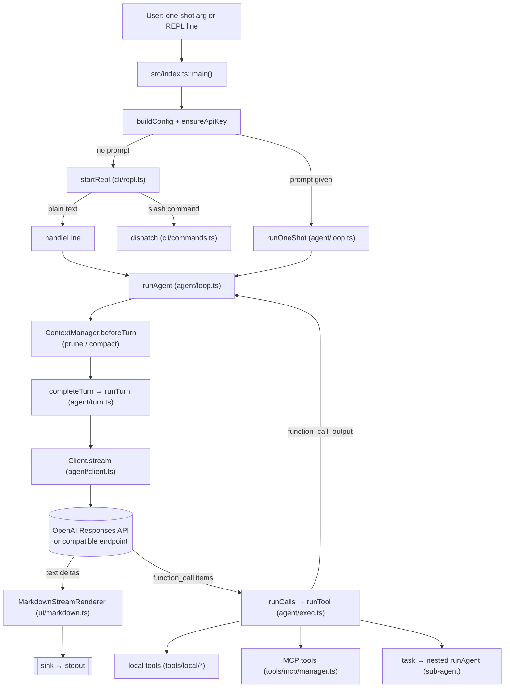
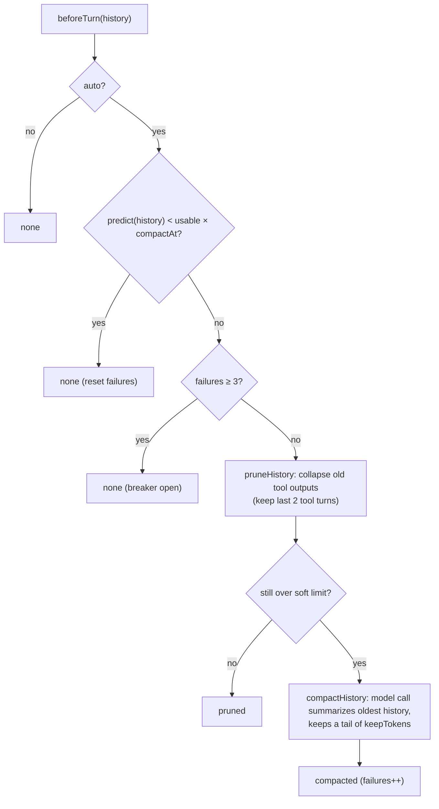
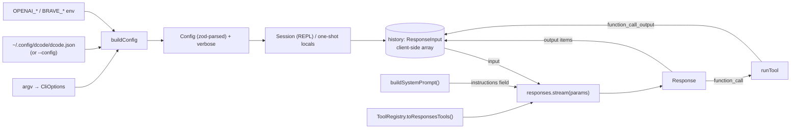
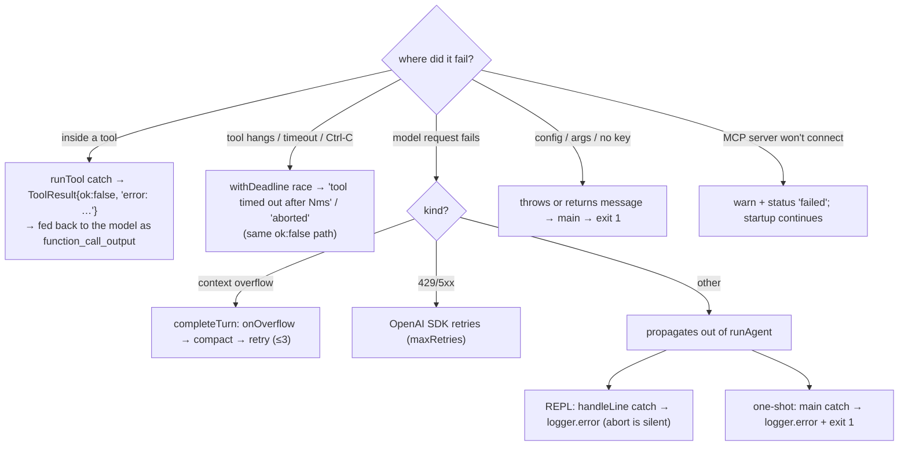

# Developer Onboarding

This guide gets an experienced TypeScript/Node developer productive in `dcode`. Claims were checked against the source, `package.json`, the config files, and the tests at version `0.18.0` (plus the unreleased work in `CHANGELOG.md`). Anything inferred rather than verified is marked **Inference** or listed in [§21](#21-known-unknowns).

`src/agent/loop.ts::runAgent()` means "the function `runAgent` in that file". Line numbers are omitted because they drift.

---

## Start here (10 minutes)

| You want to know… | Short answer | Details |
| ----------------- | ------------ | ------- |
| **How do I run it?** | `pnpm install`, then try the no-key smoke test in §5.2. To talk to a real model, set `OPENAI_API_KEY` (or point `OPENAI_BASE_URL` at a local endpoint) and run `node src/index.ts` **from a scratch directory**, because dcode edits whatever directory it starts in. | [§5](#5-getting-started) |
| **Where does execution begin?** | `src/index.ts::main()`. It ends up in `startRepl` (`src/cli/repl.ts`) or `runOneShot` (`src/agent/loop.ts`), and both call `runAgent`. | [§6](#6-entry-points) |
| **How does a feature flow through the system?** | A prompt goes `handleLine` → `runAgent`, which repeats: stream a model turn → run the tools it asked for → append the results to `history`. See the worked example with real data. | [§7](#7-how-the-application-works), [§7.5](#75-worked-example-one-prompt-one-tool-call) |
| **Where do I implement my change?** | See the table below. | [§13](#13-common-development-tasks) |
| **How do I run tests?** | `pnpm test`. It's hermetic (no key, no network) and takes about 5 s. One file: `pnpm vitest run <file>`. | [§12](#12-testing) |
| **Where do I debug a failure?** | Re-run with `--verbose`. Put breakpoints in `handleLine`, `runAgent`, `runTurn`, `runTool`. See what failures look like. | [§14](#14-debugging-guide) |

**Where does my change go?**

| If you're adding or changing… | Start in | Also touch |
| ----------------------------- | -------- | ---------- |
| a **tool** | `src/tools/local/*.ts` | set `category`; register in `src/tools/index.ts`; **add the name to the pinned list in `tests/tools/index.test.ts`** |
| a **slash command** | `COMMANDS` in `src/cli/commands.ts` | nothing else; `/help` and tab-completion derive from it |
| a **CLI flag** | `FLAGS` in `src/cli/args.ts` | `CliOptions`, `parseCli`, then `buildConfig` |
| a **config key** | `src/config/schema.ts` | `buildConfig` (env), `formatConfig` in `commands.ts`, `client.ts` if it changes the API request |
| **what the model is told** | `src/agent/system.ts` | `tests/agent/system.test.ts` |
| **loop behaviour** (retries, iteration cap) | `src/agent/loop.ts` | `tests/agent/loop.test.ts` |
| **context / compaction** | `src/agent/context/` | `tests/agent/context/` |
| **terminal output** | `src/ui/` | `tests/ui/` |

**Suggested first hour:** run the smoke test (§5.2) → read §2 and §7 → read the first four files in §18 → follow the add-a-tool walkthrough in §13.

---

## 1. What This Project Is

`dcode` is a CLI coding agent. You run it in a project directory and talk to a model that can read, search, and edit files, run shell commands, browse the web, and call MCP tools, all on your machine.

- **Two modes** (`src/index.ts::main`): `dcode "do X"` runs one prompt to completion (one-shot). `dcode` with no prompt opens an interactive REPL with slash commands.
- **Model access:** the OpenAI **Responses API** through the official `openai` SDK. The base URL is configurable, so any OpenAI-compatible `/v1/responses` endpoint works (the stress test and `README.md` use a local Ollama endpoint). The default model is `gpt-5.4-mini` (`src/config/schema.ts`).
- **No build step:** Node 26 runs the `.ts` files directly by stripping types (`package.json` → `"bin": {"dcode": "src/index.ts"}`, `"engines": {"node": ">=26.0.0"}`). `tsc` is used only as a type-check gate (`noEmit`).
- **No permission layer, on purpose.** Every tool call, including `run_shell`, file writes, and MCP tools, runs the moment the model requests it. There is no approval prompt, allow-list, or sandbox. The `README.md` opens with a warning about this, and `AGENTS.md` has a "Security model" section. A permissions system (phase "P5") was designed and then removed. (`P<n>` ids are phases in `PLAN.md` §8, and decision letters `A`–`L` are in its §6. See the [glossary](#20-glossary).) Treat dcode as "the model has my shell".
- **State is in-memory.** The conversation, task list, and background processes live for one run. The only files dcode writes are the global config (`~/.config/dcode/dcode.json`, via `/key`) and what the user asks it to write (`/save`, tool edits).

Version at time of writing: `0.18.0` (`package.json`), with substantial unreleased work in `CHANGELOG.md`.

**Why it exists** (`PLAN.md` §1–§3): a small, modular, locally run agent, favouring correctness and simplicity over breadth, with no build step and every behaviour covered by fast deterministic unit tests. Non-goals: permissions/sandboxing, persistence across runs, any UI beyond the terminal, and providers other than OpenAI-compatible ones.

---

## 2. Mental Model

Think of dcode as **a loop around one HTTP streaming call**:

1. Send the conversation plus tool definitions to the model.
2. Stream any text to the terminal as it arrives.
3. If the model asked for tools, run them and append the results to the conversation.
4. Repeat until the model answers without asking for tools.

Everything else (config, REPL, context compaction, sub-agents, MCP, rendering) supports that loop.



Two ideas to hold onto:

- **The conversation is a client-side array** (`history: ResponseInput`). dcode sends it in full on every request (`store: false` by default) and mutates it as it goes: appending, pruning, compacting.
- **The system prompt is not part of that array.** It travels in the Responses API `instructions` field and is rebuilt for each prompt (`buildSystemPrompt()`).

---

## 3. Repository Map

| Path | Purpose | Important files |
| ---- | ------- | --------------- |
| `src/index.ts` | Process entry point (`bin`). Wires CLI → config → auth → one-shot or REPL. | `main()` |
| `src/cli/` | Terminal front end: flag parsing, REPL, slash commands, startup auth, `/key` storage, tab-completion, `$EDITOR` integration. | `args.ts`, `repl.ts`, `commands.ts`, `auth.ts`, `keys.ts`, `completer.ts`, `editor.ts` |
| `src/config/` | Config schema (zod) and layered loading. | `schema.ts`, `config.ts` |
| `src/agent/` | The agent runtime: loop, single turn, tool execution, model client, prompt, sub-agent types, and the shared startup wiring. | `loop.ts`, `turn.ts`, `exec.ts`, `client.ts`, `system.ts`, `subagent.ts`, `runtime.ts`, `types.ts` |
| `src/agent/context/` | Context-window management: token estimate, prune, compact, the manager. | `manager.ts`, `compact.ts`, `prune.ts`, `tokens.ts` |
| `src/tools/` | Tool framework: registry, `defineTool`, the hub that registers built-ins. | `registry.ts`, `index.ts` |
| `src/tools/local/` | Built-in tools, split by concern, plus shared helpers. | `fs.ts`, `search.ts`, `exec.ts`, `process.ts`, `web.ts`, `todo.ts`, `question.ts`, `task.ts`; helpers `paths.ts`, `http.ts` |
| `src/tools/mcp/` | MCP client: connects servers, wraps their tools as `ToolDefinition`s. | `manager.ts` |
| `src/ui/` | Terminal rendering: streamed markdown, tool-progress display, the output `RunSink` seam. | `markdown.ts`, `tools.ts`, `sink.ts` |
| `src/util/` | Logger (stderr), colour, version. | `log.ts`, `color.ts`, `version.ts` |
| `src/types/marked-terminal.d.ts` | Local ambient types (the package ships none; `@types/marked-terminal` is stale). | |
| `tests/` | Vitest suites mirroring `src/`, plus shared fakes. | `helpers.ts`, `agent/loop.test.ts`, `cli/repl.test.ts`, `tools/local.test.ts` |
| `scripts/live-stress.ts` | Live end-to-end test against a real model (`pnpm stress`). Not part of `pnpm test`. | |
| `scripts/gaia/` | Python harness that runs dcode one-shot against the GAIA benchmark. Standalone. | `run_gaia.py` |
| `README.md`, `AGENTS.md`, `CLAUDE.md`, `PLAN.md`, `CHANGELOG.md`, `ONBOARDING.md` | Docs. `README.md` is user-facing. `AGENTS.md` is the developer guide (rules, conventions, security model). `CLAUDE.md` is a short pointer plus the hard constraints and the easy-to-break list, for Claude Code. `PLAN.md` has the module tree, the 12 locked decisions (§6), and the phase history. This file explains how the system works. | |
| `package.json`, `tsconfig.json`, `vitest.config.ts`, `.prettierrc` | Tooling config. | |

Note: `dcode.json` is git-ignored because it can hold secrets (`.gitignore`). CI is `.github/workflows/ci.yml` (typecheck, format check, tests on Node 26).

---

## 4. Technology Stack

| Area | Choice | Source |
| ---- | ------ | ------ |
| Runtime | Node.js `>=26` (verified with v26.8.2) | `package.json` `engines` |
| Language | TypeScript `^7.0.2`, strict ESM, `erasableSyntaxOnly`, `verbatimModuleSyntax` | `tsconfig.json` |
| Package manager | pnpm only (verified with 12.4.1) | `AGENTS.md`, `pnpm-lock.yaml` |
| Tests | Vitest `^4.1.11`, `tests/**/*.test.ts`, `FORCE_COLOR=1` | `vitest.config.ts` |
| Formatting | Prettier `^3.9.6` (no semicolons, single quotes, trailing commas, width 80); `*.md` is excluded | `.prettierrc`, `.prettierignore` |
| Linting | None. The gate is `tsc --noEmit` plus Prettier. | `package.json` |
| Build | None. `node src/index.ts` runs the source. | |
| Database / storage | None. In-memory state and one JSON config file. | |

Runtime dependencies, and why each exists:

| Package | Why it's here |
| ------- | ------------- |
| `openai` `^7.15.0` | Responses API client. dcode uses `client.responses.stream()`, and the SDK helper `toResponseInputItems()` (`agent/loop.ts`) to replay model output into history. |
| `zod` `^4.6.4` | Config schema and tool parameter schemas. Always imported from `zod/v4`. `z.toJSONSchema` produces the tool JSON Schema (`tools/registry.ts`). |
| `execa` `^10.0.1` | Spawning `run_shell`, background processes, and ripgrep, with signal handling (`cancelSignal`) and descendant killing. |
| `@vscode/ripgrep` | Bundled `rg` binary that backs `grep` and `glob` (no separate install). |
| `marked`, `marked-terminal` | Markdown → ANSI rendering of streamed output (`ui/markdown.ts`). |
| `node-html-markdown` | HTML → Markdown for `web_fetch`. |
| `@clack/prompts` | The masked API-key prompt (`cli/auth.ts`), `ask_user` menus (`tools/local/question.ts`), and `isCI()` (`ui/tools.ts`). |
| `@modelcontextprotocol/sdk` | MCP client transports (stdio, streamable HTTP) in `tools/mcp/manager.ts`. |

---

## 5. Getting Started

Prerequisites: Node.js ≥ 26 and pnpm (verified with Node v26.8.2 and pnpm 12.4.1). There is no build step and no production build. Every command below is a script in `package.json` or a plain `node src/index.ts` invocation.

### 5.1 Install and verify

```bash
pnpm install
pnpm typecheck       # tsc --noEmit
pnpm format:check    # prettier --check .
pnpm test            # vitest run — all green, ~5 s (459 tests in 33 files at time of writing)
```

These three checks are also the pre-commit gate (`AGENTS.md`).

### 5.2 Smoke test with no key and no model

You can exercise the REPL, the slash commands, and the tool registry without an API key or network model:

```bash
printf '/help\n/tools\n/config\n/exit\n' | \
  XDG_CONFIG_HOME=$(mktemp -d) OPENAI_API_KEY=x OPENAI_BASE_URL=http://localhost:9 \
  node src/index.ts
```

Why it works: startup checks the key with `GET {baseURL}/models`, but only a definite 401/403 blocks startup. An unreachable endpoint counts as "unknown" and startup continues (`cli/auth.ts::ensureApiKey`). The temporary `XDG_CONFIG_HOME` keeps this run away from your real `~/.config/dcode/dcode.json`. The output contains readline cursor-control escape codes because the input is piped. That's normal. You should see the command list, the effective config, and the 20 built-in tool names. Any prompt that needs a model fails with `[error] Connection error.` (about 3 s, after SDK retries). When you drive the REPL with piped input as above, you may also see `[error] readline was closed`, because stdin ends while the turn is still running. That's an artefact of piping, not a second failure.

Without `OPENAI_API_KEY`, dcode prints the setup guidance and exits 1. This includes the REPL when stdin isn't a TTY, because the interactive key prompt only appears on a real terminal.

### 5.3 Run against a model

**OpenAI** (or any OpenAI-compatible service):

```bash
export OPENAI_API_KEY=sk-...             # or: run dcode on a TTY and paste the key when asked,
                                         # or inside the REPL: /key set openai sk-...
node src/index.ts                        # REPL
node src/index.ts "read note.txt and count its words"   # one-shot
```

**A local endpoint (for example Ollama):**

```bash
OPENAI_BASE_URL=http://localhost:11434/v1 OPENAI_API_KEY=ollama OPENAI_MODEL=<model> node src/index.ts "…"
```

The endpoint must implement the Responses API with streaming events the OpenAI SDK can parse. Compatibility varies by model: with a local Ollama server, one model worked end to end and another failed with `[error] missing content at index 0` (see [§14](#14-debugging-guide)). The default `gpt-5.4-mini` is what the code is tuned for.

A successful one-shot run that reads a file looks like this when output is piped (on a terminal, the `›` line becomes a live counter that settles into a one-line summary):

```text
› read_file: ✓ done (0.0s)

The file note.txt contains 6 words.
```

### 5.4 Run it from a scratch directory

dcode acts on the directory it is started in (`process.cwd()`) and runs every tool call without asking. Start it in a throwaway directory and invoke it by path:

```bash
cd "$(mktemp -d)" && node /path/to/dcode/src/index.ts
```

or run `pnpm link` once (from the README; not verified here) so `dcode` is on your `PATH`. Avoid pointing a real model at the dcode repo itself unless you intend it to edit dcode. **Inference:** `pnpm dev` (`node --watch src/index.ts`) restarts the process when watched source files change, so a model editing dcode's own source would restart your session mid-run. Use `pnpm dev` for working on dcode, not for long agent sessions.

### 5.5 Other commands

| Command | What it does |
| ------- | ------------ |
| `pnpm start` | `node src/index.ts` |
| `pnpm dev` | `node --watch src/index.ts` |
| `pnpm format` | `prettier --write .` (Markdown is excluded) |
| `pnpm test:watch` | Vitest in watch mode |
| `pnpm vitest run tests/cli/repl.test.ts` | One test file |
| `pnpm vitest run tests/cli/args.test.ts -t "unknown flag"` | Only tests whose name matches |
| `pnpm stress` | **Live** end-to-end test against your configured model (real tokens) |
| `pnpm stress deep-chain burst` | Only the named scenarios, and/or the concurrency burst |

The published files are `src`, the docs, and `LICENSE` (`package.json` → `files`).

---

## 6. Entry Points

### 6.1 The CLI binary: `src/index.ts::main()`

```text
src/index.ts (#!/usr/bin/env node)
  └─ if (import.meta.main) main()               ← so tests can import main() without running it
       ├─ parseCli(argv)                         cli/args.ts   (strict parseArgs; unknown flag = error)
       ├─ --version / --help → print, return
       ├─ buildConfig(args)                      config/config.ts  (file → env → argv, zod-parsed)
       ├─ createLogger(config); log configWarnings(config)
       ├─ ensureApiKey(config, logger, !args.prompt)   cli/auth.ts
       │     no key → prompt on a TTY (REPL only) or return NO_KEY_HELP → exit 1
       │     401/403 from GET {base}/models → exit 1;  other failures → continue
       ├─ no prompt → startRepl(config, logger)        cli/repl.ts
       └─ prompt    → createRuntime(config, logger)      agent/runtime.ts
                      (client + TaskStore + connected MCP servers + tool registry),
                      then runOneShot(...) under a SIGINT→AbortController
                      finally: mcp.close()
     any thrown error → logger.error(message); process.exit(1)
```

Execution begins at `src/index.ts::main()`. Nothing else runs at import time, apart from the `import.meta.main` guard that calls it.

### 6.2 REPL: `src/cli/repl.ts::startRepl()`

`createSession()` (async because MCP servers connect) builds the `Session` on top of `createRuntime()`, the same startup wiring one-shot mode and `pnpm stress` use. `runRepl()` creates a `node:readline/promises` interface and runs `for await (const line of rl)`. `startRepl` wraps it in `try { … } finally { await session.mcp.close() }`.

### 6.3 One-shot: `src/agent/loop.ts::runOneShot()`

A thin wrapper. It creates a `ContextManager`, makes `history = [{role: 'user', content: prompt}]`, and delegates to `runAgent`.

### 6.4 Nested agent: `src/tools/local/task.ts` → `runAgent`

The `task` tool re-enters `runAgent` for a sub-agent (see [§8.7](#87-sub-agents)).

### 6.5 Other executables

- `scripts/live-stress.ts`: `pnpm stress`. Builds the same config/client/tools as a real session, runs scenarios, and asserts on history and UI shape.
- `scripts/gaia/run_gaia.py`: invokes dcode as a subprocess in one-shot mode. Not part of the TypeScript build.

---

## 7. How the Application Works

### 7.1 One agent run, step by step

`src/agent/loop.ts::runAgent(client, config, history, opts)`:

| # | Step | Code |
| - | ---- | ---- |
| 1 | Build a `ToolContext { root: process.cwd(), config, logger, signal, depth }`. Take `registry.toResponsesTools()` (memoized). Set `instructions = opts.instructions ?? buildSystemPrompt()`. Create the tool-progress reporter. | `runAgent` |
| 2 | Loop `i < config.maxToolIterations` (default 16). **An iteration is one model turn**, not one tool call. | `runAgent` |
| 3 | `context.beforeTurn(...)`: if the token estimate is ≥ `usable × compactAt`, prune old tool outputs and, if still over, compact. | `agent/context/manager.ts` |
| 4 | `completeTurn(...)` → `runTurn(...)` streams one model response (details in 7.2). Two recoveries live here: a context overflow triggers compact-and-retry (up to 3), and a `max_output_tokens` truncation triggers replay of the partial answer plus a user `Continue.` and a retry (up to 3). | `loop.ts::completeTurn` |
| 5 | `context.observe(response.usage, history)` recalibrates the token estimate. `pushResponseOutput` appends the response's output items to `history`. | `loop.ts` |
| 6 | `functionCalls(response)`. If none, break: the run is done. | `loop.ts` |
| 7 | `runCalls(calls, registry, ctx, progress.onResult)` executes them (7.3). `appendToolOutputs` pushes a `function_call_output` per call. `progress.renderBatch(results)`. | `loop.ts`, `agent/exec.ts` |
| 8 | If `signal.aborted`, freeze the progress display and throw `Error('aborted')`. This happens **after** all outputs are recorded, so history stays balanced and resumable. | `loop.ts` |
| 9 | On the last permitted iteration with calls still pending: set `truncated = true` and log a warning that names `maxToolIterations`. | `loop.ts` |
| 10 | Return `AgentResult { text, truncated, inputTokens, outputTokens }`. The tokens come from the final turn's `usage`. | `loop.ts` |

### 7.2 One model turn

```text
runTurn(client, config, input, opts)                       agent/turn.ts
  ├─ client.stream(input, { tools, instructions, signal,
  │                          reasoningEffort, verbosity })  agent/client.ts
  │     └─ client.responses.stream({ model, input, max_output_tokens: config.maxTokens,
  │            stream: true, store: config.stateful, [tools] [instructions]
  │            [reasoning.effort] [text.verbosity] }, { signal })
  │        yields `response.output_text.delta` strings; `output_item.added` for a reasoning item or
  │        function_call is reported via opts.onActivity (→ progress.onActivity); every other SDK event is dropped
  ├─ for each delta: MarkdownStreamRenderer.push(delta) → sink   (only block-complete text is emitted)
  │      first visible write calls opts.onBeforeText  →  progress.freeze()
  ├─ response = await stream.finalResponse()     ← the SDK's aggregated Response (tool calls, usage, reasoning)
  └─ md.finalize() → sink;  return response
```

Rendering comes from the deltas, but history and tool calls come from `finalResponse()`.

### 7.3 One tool call

```text
runCalls(calls, registry, ctx, onResult)                   agent/exec.ts
  for each call in emission order:
    tool = registry.get(name)
    tool exists and tool.parallel !== false → queue in a parallel batch
    otherwise                                → flush the batch (Promise.all), then run this one alone
  each call → exec():   aborted? → {ok:false,'aborted'}    unknown tool? → {ok:false,'error: unknown tool'}
                        else runTool(...)
runTool(call, tool, ctx)
  ├─ JSON.parse(call.arguments) → tool.parameters.parse(raw)     ← zod validation
  ├─ withDeadline(tool.execute(args, ctx), config.toolTimeout, ctx.signal)   ← real Promise.race
  └─ any throw becomes { ok:false, output:'error: <message>' };   output truncated to maxToolOutputBytes
```

`runTool` never throws. Failures come back to the model as `function_call_output` text so it can self-correct.

### 7.4 One REPL line

```text
runRepl: for await (line of rl)
  └─ runTurn wrapper: new AbortController (`ac` doubles as the "busy" flag for SIGINT)
       └─ handleLine(session, line, {sink, signal, asPrompt})           cli/repl.ts
            ├─ "" → ok
            ├─ starts with "/" (and not asPrompt) → parseCommand → dispatch → COMMANDS[...].handler
            │      returns 'ok' | 'exit' | 'edit'   ('edit' asks the loop to open $VISUAL/$EDITOR)
            └─ else: history.push({role:'user'}) → runAgent(session.client, config, session.history, {...})
                     → session.lastUsage = tokens;   print a hint if result.truncated
                     catch → clear lastUsage; logger.error unless it's an abort
  then: refreshPrompt()  → two-line prompt: dim status line (model · turn N · ↑in ↓out · used/usable) + "> "
```

The sequence below shows one prompt end to end, from the REPL line to the returned `AgentResult`.

```mermaid
sequenceDiagram
    participant U as User
    participant R as repl.ts::handleLine
    participant L as loop.ts::runAgent
    participant C as ContextManager
    participant T as turn.ts::runTurn
    participant A as OpenAI Responses API
    participant X as exec.ts::runCalls/runTool
    U->>R: text line
    R->>L: runAgent(history, tools, context)
    loop up to maxToolIterations
        L->>C: beforeTurn(history)
        L->>T: completeTurn → runTurn
        T->>A: responses.stream(input, instructions, tools)
        A-->>T: output_text deltas (rendered live)
        A-->>T: finalResponse (function_call items, usage)
        L->>L: observe(usage); push output into history
        alt has function_calls
            L->>X: runCalls(calls)
            X-->>L: results (parallel read-only, sequential mutating)
            L->>L: push function_call_output items
        else no calls
            L-->>R: AgentResult
        end
    end
```

### 7.5 Worked example: one prompt, one tool call

Suppose you type `What is this project?` in the REPL and the model answers by calling `read_file` once. Here is `history` afterwards. It was produced by running the real `runAgent` with a scripted model (tool output shortened):

```json
[
  { "role": "user", "content": "What is this project?" },
  { "type": "function_call", "call_id": "call_1", "name": "read_file",
    "arguments": "{\"path\":\"package.json\"}", "status": "completed", "id": "fc_1" },
  { "type": "function_call_output", "call_id": "call_1",
    "output": "1\t{\n2\t  \"name\": \"dcode\",\n3\t  \"version\": …" },
  { "type": "message", "role": "assistant", "status": "completed",
    "content": [{ "type": "output_text", "text": "It is dcode.", "annotations": [] }] }
]
```

How each item got there:

1. `handleLine` pushes the **user** item, then calls `runAgent`.
2. **Iteration 0:** `runTurn` streams the response. The model produced no text, only a `function_call`, so nothing is printed. `pushResponseOutput` appends the `function_call` item. With a reasoning model, a `reasoning` item would sit just before it.
3. `runCalls` runs `read_file` (read-only, so it's parallel-eligible). `appendToolOutputs` adds the matching `function_call_output` with the same `call_id`. `renderBatch` prints `› read_file: ✓ done (0.0s)`, or updates the live counter on a TTY.
4. **Iteration 1:** the whole array is sent again. This time the model streams text, which the markdown renderer prints as it arrives. The final `message` item is appended, there are no function calls, and the loop breaks.
5. `AgentResult` is `{ text: 'It is dcode.', truncated: false, inputTokens: 900, outputTokens: 20 }` in this scripted example. `handleLine` stores the token counts for the status line.

The next prompt sends this entire array again, plus the new user item. That is why `ContextManager` exists.

---

## 8. Major Components

### 8.1 CLI and REPL

**Purpose:** parse flags, run the interactive loop, dispatch slash commands, show status.
**Location:** `src/cli/`.
**Public API:** `parseCli`, `formatFlags` (`args.ts`); `startRepl`, `createSession`, `handleLine`, `formatStatusLine` (`repl.ts`); `COMMANDS`, `SLASH_COMMANDS`, `parseCommand`, `dispatch`, `Session`, `HandleResult` (`commands.ts`); `ensureApiKey`, `validateApiKey` (`auth.ts`); `setGlobalKey`, `unsetGlobalKey`, `KEY_PROVIDERS` (`keys.ts`).
**Dependencies:** config, agent loop, tools index, MCP manager, ui.
**Consumers:** `index.ts`; `scripts/live-stress.ts` (`formatMcpServers`).
**Notes:**
- `FLAGS` in `args.ts` is the single table feeding both `parseArgs` options and `--help`. Add a flag there.
- Slash commands are the `COMMANDS` array in `commands.ts`. `/help` and tab-completion (`SLASH_COMMANDS`, built from names plus aliases) derive from it.
- Ctrl-C: aborts the running turn. With nothing running, one press prints a hint and a second within 2 s exits.
- `/key` always writes to the **global** config, even in a `--config <path>` session. It updates `session.config` in memory so it works for the current session.

### 8.2 Config

**Purpose:** one validated `Config` object.
**Location:** `src/config/schema.ts` (zod schema, source of truth), `src/config/config.ts` (`buildConfig`, `readConfigFile`, `globalConfigPath`, `normalizeBaseURL`, `configWarnings`).
**Public API:** `Config` = `z.infer<typeof configSchema> & { verbose: boolean }`.
**Consumers:** nearly everything, since `Config` is passed explicitly rather than read from a global.
**Notes:** see [§10](#10-configuration).

### 8.3 Agent runtime

**Purpose:** the loop, one turn, tool execution, the model client.
**Location:** `src/agent/loop.ts`, `turn.ts`, `exec.ts`, `client.ts`, `types.ts`.
**Public API:**

| Symbol | File | Role |
| ------ | ---- | ---- |
| `runAgent`, `runOneShot`, `AgentResult` | `loop.ts` | Orchestration. |
| `runTurn`, `TurnOpts` | `turn.ts` | One streamed model call plus rendering. |
| `createRuntime`, `Runtime` | `runtime.ts` | The session-lived pieces every entry point needs: `Client`, `TaskStore`, connected MCP servers, and the tool registry. Used by `index.ts`, `createSession`, and the stress script. |
| `runTool`, `runCalls` | `exec.ts` | Execute tool calls with deadline, truncation, parallel/sequential scheduling. |
| `createClient`, `Client`, `ModelStream`, `StreamActivity`, `isContextOverflowError` | `client.ts` | Thin wrapper over the OpenAI SDK. |
| `ToolDefinition`, `ToolContext`, `ToolCall`, `ToolResult`, `TaskStore`, `Todo`, `ResponseItemFields`, `isUserPrompt`, `CONTINUE_PROMPT` | `types.ts` | Shared types, the todo store class, and the prompt-vs-`Continue.` helper. |

**Dependencies:** `openai` SDK, context manager, tool registry, `ui/tools.ts` (progress), `ui/markdown.ts`.
**Consumers:** `index.ts`, `repl.ts`, `tools/local/task.ts`, the stress script.
**Notes:**
- `Client` is an interface with one method, `stream()`. Tests substitute fakes (`tests/helpers.ts::fakeClient`) without touching the network.
- `ModelStream` is `AsyncIterable<string>` plus `finalResponse()`. Only text deltas are yielded; the model starting a reasoning item or tool call is reported through the separate `onActivity` callback so the UI can show life during a silent phase.
- `pushResponseOutput` uses the SDK's `toResponseInputItems()` so `reasoning` items are replayed (reasoning models require them on stateless turns), then `stripParsedArguments` removes a `parsed_arguments` field the API rejects on replay.

### 8.4 System prompt

**Purpose:** build the `instructions` string.
**Location:** `src/agent/system.ts`.
**Public API:** `buildSystemPrompt(opts?: { subagents?: boolean; root?: string })`, `BASE_SYSTEM_PROMPT`.
**Notes:**
- Composed from `CORE_SYSTEM_PROMPT` + optional `SUBAGENT_SECTION` + `STYLE_SECTION`, then, if present, a **Project instructions** section from `AGENTS.md` (falling back to `CLAUDE.md`) in the cwd, capped at 32,000 characters. Last come the working directory, platform, and date lines. Static text first keeps the prefix cache-friendly.
- `general` sub-agents call it with `subagents: false`. `explore` has its own fixed prompt (`agent/subagent.ts::EXPLORE_PROMPT`).
- Tests pass `root` (a temp dir) so this repo's own `AGENTS.md` doesn't leak into assertions.

### 8.5 Context management

**Purpose:** keep the request inside the model's window.
**Location:** `src/agent/context/`.
**Public API:** `ContextManager` (`beforeTurn`, `observe`, `predict`, `onOverflow`, `manual`, `report`, `usable`); `pruneHistory`; `compactHistory`; `estimateHistory`, `contentToText`.
**Dependencies:** `Client` (compaction is a model call), `TaskStore` (the task list is injected into the summary as authoritative).
**Consumers:** `loop.ts`, `repl.ts` (`/compact`, `/context`, status line), `task.ts` (a per-sub-agent manager with `auto: false`).
**Behaviour** (`manager.ts`, `compact.ts`, `prune.ts`):



- `usable = window − reserved`. Estimates are ~4 chars/token over the history, multiplied by a `ratio` learned from real `usage.input_tokens` (`observe`).
- `onOverflow` (used after a context-length error) prunes first, then compacts, and the loop retries. A successful prune doesn't count toward the breaker; a compaction attempt does.

### 8.6 Tool framework and built-in tools

**Purpose:** define, register, schema-ify, and run tools.
**Location:** `src/tools/registry.ts` (`ToolRegistry`, `defineTool`, `toResponsesTool`), `src/tools/index.ts` (`createLocalTools`), `src/tools/local/*`.
**Built-in tools (20):** `read_file`, `list_dir`, `grep`, `stat`, `glob`, `write_file`, `edit_file`, `move_file`, `copy_file`, `delete_file`, `make_dir`, `run_shell`, `run_process`, `read_process`, `kill_process`, `web_search`, `web_fetch`, `todowrite`, `ask_user`, `task`. `createLocalTools` registers them all, plus any MCP tools passed in. `task` is registered **last** so its description reflects the full tool set.
**Notes:**
- A tool is `defineTool({ name, description, parallel?, parameters: zod, execute(args, ctx) => Promise<string> })`. `args` is inferred from the zod schema, so don't hand-write a `ToolDefinition<{…}>` annotation.
- Tools throw to signal failure. The thrown message becomes the model-visible `error: …`.
- `parallel: false` marks mutating or stateful tools: `write_file`, `edit_file`, `move_file`, `copy_file`, `delete_file`, `make_dir`, `run_shell`, `run_process`, `kill_process`, `ask_user`, `task`. Everything else defaults to parallel-eligible. `read_process` is read-only, so it's parallel.
- `createLocalTools` throws if a sub-agent policy names a tool nobody registered (`unknownAgentTools`).
- Filesystem tools confine paths via `tools/local/paths.ts::resolvePath` (lexical `..` check plus a `realpath` check that also catches symlink escapes). `run_shell` is **not** confined beyond `cwd`.
- Shared spawn options live in `tools/local/exec.ts` (`baseExecOptions`, `safeEnv`, `childMaxBuffer`). `safeEnv` drops env vars whose names match `KEY|SECRET|TOKEN|PASSWORD|PASS|CREDENTIAL|PRIVATE` so children can't read secrets.
- `grep`/`glob` spawn `rgPath` directly, not via `exec.ts`, because ripgrep's exit code 1 means "no matches", not failure.
- `web_fetch`/`web_search` go through `tools/local/http.ts::fetchSafely` (timeout plus signal) and `readBounded`. There is deliberately **no host filtering**.

### 8.7 Sub-agents

**Purpose:** delegate self-contained work to a nested agent with its own history.
**Location:** `src/agent/subagent.ts` (agent types), `src/tools/local/task.ts` (the tool).
**Behaviour:**
- Two types: `general` (policy `{deny: ['task']}`, so "everything except `task`") and `explore` (policy `{allow: [read_file, list_dir, grep, stat, glob, web_search, web_fetch]}`, read-only by construction).
- `runSubAgent` builds a filtered `ToolRegistry`, rebinds `todowrite` to a fresh `TaskStore` (so it can't overwrite the parent's plan), uses a `ContextManager` with `auto: false`, a silent sink, `depth + 1`, and its own `instructions`. `MAX_DEPTH = 1`.
- The result is wrapped as `<task state=… description=… agent=…>…</task>` and returned to the parent as a normal tool result.
- Sub-agents run one at a time (`task` is `parallel: false`) and are never resumable.

### 8.8 MCP integration

**Purpose:** expose external MCP servers' tools like built-ins.
**Location:** `src/tools/mcp/manager.ts::connectMcpServers`.
**Behaviour:**
- Servers come from `config.mcpServers`. `enabled` defaults to **false**. Transports are stdio (`type: local`) or streamable HTTP (`type: remote`, static headers). `type` is inferred from `command`/`url`.
- All servers connect in parallel (10 s timeout each). A failure is logged and recorded as `status: 'failed'`, never fatal.
- Tools are named `mcp__<server>__<tool>`. Their JSON Schema is used **verbatim** (`ToolDefinition.jsonSchema`), and `parameters` is a permissive passthrough.
- `parallel` is `tool.annotations?.readOnlyHint ?? false`.
- A header or env value that is exactly `${VAR}` is expanded from the environment at connect time. An unset variable fails just that server.
- Used by both `index.ts` (one-shot) and `repl.ts::createSession`, and closed on exit.

### 8.9 UI rendering

**Purpose:** everything the terminal shows besides raw logs.
**Location:** `src/ui/`.
**Notes:**
- `markdown.ts`: `MarkdownStreamRenderer` buffers deltas and emits only text up to a blank-line boundary outside an unclosed code fence, so partial markdown never shows. It re-renders the safe prefix each time and emits only new lines. It patches two `marked-terminal` bugs (`text` renderer, spurious ANSI-only lines).
- `tools.ts::createToolProgress`: **live mode** (a real TTY, not CI, not `--verbose`) shows one in-place counter that freezes into a category summary (`2 search · 13 read · 8.5s`). Otherwise it prints one `› name: ✓ done (0.3s)` line per call. The family a tool counts under comes from its own `category` (a tool without one, such as an MCP tool, counts as `run`). `--verbose` also echoes raw tool output.
- `sink.ts`: `RunSink { write(text) }` is the seam between the agent and stdout; `CapturingSink` collects output for tests and the stress script.

### 8.10 Utilities

`util/log.ts` (`createLogger`, `errorMessage`, `isAbortError`), `util/color.ts` (`paintFor(color)`, the one place `styleText` is applied), `util/version.ts` (`getVersion`).

---

## 9. Important Data Flow



**The important types:**

| Type | Defined in | Meaning |
| ---- | ---------- | ------- |
| `CliOptions` | `cli/args.ts` | Parsed flags, plus `prompt` (positionals joined with spaces). |
| `Config` | `config/schema.ts` | Validated settings. `verbose` is attached by `buildConfig` from argv and is **not** in the schema. |
| `ResponseInput` / `OpenAIResponse` | re-exported from the SDK by `agent/client.ts` | History items and one response. |
| `ToolDefinition<P>`, `ToolContext`, `ToolCall`, `ToolResult` | `agent/types.ts` | Tool contract and the outcome (`{id, name, output, ok, ms}`). |
| `AgentResult` | `agent/loop.ts` | `{ text, truncated, inputTokens?, outputTokens? }`. |
| `Session` | `cli/commands.ts` | REPL state: `config, logger, client, history, tools, context, tasks, root, mcp, lastUsage?`. |
| `TaskStore` / `Todo` | `agent/types.ts` | The in-session todo list. `todowrite` replaces the whole list each call. |

**What lives in `history`:** user messages (`{role:'user', content}`), assistant `message` items, `reasoning` items, `function_call` items, and `function_call_output` items. Every `function_call` must have a matching output, or the API rejects the next request. The loop, the abort path, and `compactHistory` (which cuts on a `user` boundary) all preserve that.

**Who mutates `history`:** `runAgent` (push), `pruneHistory` (rewrites old `function_call_output.output` in place), `ContextManager.compact` (`splice`), `/undo` (`splice` from the last real prompt), `/reset confirm` (replaces the array). `Session.history` is the same array `runAgent` receives, so these changes are visible everywhere.

---

## 10. Configuration

**Precedence (highest wins):** CLI flags > env > global config file > schema defaults (`config/config.ts::buildConfig`).

- The file is `$XDG_CONFIG_HOME/dcode/dcode.json` (default `~/.config/dcode/dcode.json`; a relative `XDG_CONFIG_HOME` is ignored), or an explicit `--config <path>`. A missing explicit path is an error. A missing default file means "use defaults". There is **no repo-local config**.
- `readConfigFile` parses with `configSchema.strict()`, so a typo'd key (including inside `context`) fails loudly with `Failed to load config <path>: …`. `buildConfig`'s own parse is non-strict.
- Env overrides applied in `buildConfig`: `OPENAI_API_KEY`, `OPENAI_BASE_URL` (normalized to end in `/v1`), `OPENAI_MODEL`, `BRAVE_API_KEY`, `BRAVE_ENDPOINT`. CLI overrides: `--model`, `--no-color`, `--verbose`.

**Environment variables**

| Variable | Required | Purpose | Example |
| -------- | -------- | ------- | ------- |
| `OPENAI_API_KEY` | Yes (or stored) | API key. If missing on a TTY REPL start, dcode prompts and saves it. | `sk-…` |
| `OPENAI_BASE_URL` | No | Alternate OpenAI-compatible endpoint. | `http://localhost:11434/v1` |
| `OPENAI_MODEL` | No | Default model id. | `gpt-5.4-mini` |
| `BRAVE_API_KEY` | For `web_search` | Brave Search key. | `BSA…` |
| `BRAVE_ENDPOINT` | No | Override the Brave endpoint (tests, proxies). Not listed in the README. | `https://proxy.example/search` |
| `XDG_CONFIG_HOME` | No | Base dir of the global config. | `~/.config` |
| `VISUAL` / `EDITOR` | For `/edit` | Editor for composing prompts (`VISUAL` wins). | `code --wait` |
| `${VAR}` in MCP `headers`/`env` | Per server | Whole-value placeholders for MCP secrets. | `"Authorization": "${MY_TOKEN}"` |

**Config keys** (`config/schema.ts`)

| Key | Default | Notes |
| --- | ------- | ----- |
| `model` | `gpt-5.4-mini` | |
| `baseURL` | unset | Must be an http(s) URL. |
| `apiKey`, `braveApiKey` | unset | Secrets. `/key set|unset` writes them. |
| `braveEndpoint` | unset | http(s) URL. |
| `color` | `true` | `--no-color` sets false. |
| `maxToolIterations` | `16` | Model turns per `runAgent` call. `/limit <n>` changes it at runtime. |
| `maxToolOutputBytes` | `32768` | Tool output truncation. Also scales the child-process buffer (`childMaxBuffer`). |
| `maxTokens` | `8192` | Sent as `max_output_tokens`. |
| `reasoningEffort`, `verbosity` | unset | Sent only if set; agent turns and sub-agents only, not compaction. |
| `maxRetries` | `3` | SDK-level retries (429/5xx). |
| `toolTimeout` | `30000` ms | Per tool call, enforced by `withDeadline`. |
| `stateful` | `false` | Sets `store: true` on requests. **dcode does not chain `previous_response_id`**, so this only stores server-side. |
| `ignore` | `['.git','node_modules']` | Skipped by `grep`/`glob`. |
| `context` | (object) | `auto: true`, `window: 200000`, `reserved: 20000`, `keepTokens: 15000`, `prune: true`, `compactAt: 0.85`. Validated so `keepTokens < window − reserved`. |
| `mcpServers` | `{}` | See [§8.8](#88-mcp-integration). Remote `url` is deliberately *not* validated at load, so one bad entry only fails that server. |

**Validation and warnings:** zod at load. `maxTokens >= context.reserved` is a startup **warning** (`configWarnings`), not an error.

**Secrets:** `/key` writes the global config with mode `0600` and its directory `0700` (`cli/keys.ts`). `safeEnv()` strips secret-looking variables from every spawned child. `/config` prints keys as set/unset, never their values.

Development vs production: there is no distinction. The only runtime toggle is `--verbose`.

---

## 11. Error Handling

There are **no custom error classes** (no class in `src/` extends `Error`). Errors are plain `Error`s whose messages are written to be read by the user or the model.



- **Tool errors:** `fsError` (`tools/local/paths.ts`) maps `ENOENT/EISDIR/ENOTDIR/EACCES` to actionable messages. `run_shell` reports `exit N`, `timed out`, `aborted`, or `killed (SIGNAL)` plus its output. `withDeadline` **abandons** a tool that ignores the deadline, so process-spawning and network tools also take `ctx.signal` directly to actually stop.
- **Abort:** two shapes, both treated as expected by `isAbortError`: the SDK's `APIUserAbortError` (request cancelled mid-stream) and a plain `Error('aborted')` thrown between tool calls.
- **Truncation:** `max_output_tokens` is recovered with `Continue.` (≤3). Hitting `maxToolIterations` sets `AgentResult.truncated` and warns.
- **Logging:** `createLogger` writes `[debug]` (only with `--verbose`), `[warn]`, and `[error]` to **stderr**. Stdout carries only streamed model output and the REPL prompt.
- **User-facing:** REPL command handlers are wrapped so an exception in `/save`, `/compact`, etc. logs an error instead of killing the loop.
- **Auth:** a definite 401/403 from `GET {baseURL}/models` blocks startup. Network errors, timeouts, and other statuses don't, because they don't prove the key is bad.

---

## 12. Testing

**Where:** `tests/`, mirroring `src/` (`tests/cli/args.test.ts` ↔ `src/cli/args.ts`). 33 files, 459 tests at time of writing. **Run:** `vitest run` (config in `vitest.config.ts`: `tests/**/*.test.ts`, `FORCE_COLOR=1` so colourizers emit real ANSI).

**Kinds of tests**
- **Unit (nearly everything):** deterministic, offline.
- **Integration-ish:** `tests/index.test.ts` calls `main()` with stubbed env/exit/stderr; `tests/cli/repl.test.ts` drives `handleLine` and a mocked `node:readline/promises`; `tests/tools/local.test.ts` runs real fs/shell/ripgrep tools in a temp directory.
- **Live end-to-end:** `pnpm stress` (`scripts/live-stress.ts`), which is never part of `pnpm test`. Each scenario asserts on the resulting history (tool called, todo list populated, replay shape valid), UI spacing, and markdown rendering.
- `tests/tooling.test.ts` asserts the runtime is Node ≥ 26.

**Helpers** (`tests/helpers.ts`)
- `cfg(over)`: a valid `Config` (with `verbose`).
- `fakeClient(text, split?, output?, usage?)`: a `Client` that streams text and returns a synthetic `Response`.
- `messageItem(text)`: an assistant `message` output item.
- `makeSink()`: collects written strings.

**Where the tests for a module live.** The tests mirror `src/` only loosely, so use this table when the obvious file doesn't exist:

| Code | Tests |
| ---- | ----- |
| `runTool` (`agent/exec.ts`) | `describe('runTool')` in `tests/tools/local.test.ts`; also used by `tests/tools/{todo,web,question,task}.test.ts` |
| `runAgent`, `completeTurn`, `runCalls`, `runOneShot` | `tests/agent/loop.test.ts` (`runOneShot` is also in `tests/agent/turn.test.ts`) |
| `runTurn` | `tests/agent/turn.test.ts` |
| fs / shell / process tools | `tests/tools/local.test.ts`; ripgrep error classification in `tests/tools/search.test.ts` |
| `createLocalTools` (**the exact built-in tool list**) | `tests/tools/index.test.ts` |
| `TaskStore` (now in `agent/types.ts`) | `tests/agent/todo-store.test.ts` (the file name predates the move) |
| context manager, prune, compact, tokens | `tests/agent/context/` |
| markdown / tool-progress rendering | `tests/ui/markdown.test.ts`, `tests/ui/tools.test.ts` |
| slash commands | `tests/cli/commands.test.ts` (command table) and `tests/cli/repl.test.ts` (behaviour through `handleLine`) |
| config | `tests/config/` |

**What the test run should look like.** The suite is hermetic. It passes with no `OPENAI_API_KEY` and an empty config directory, and needs no network. Some tests exercise error paths on purpose, so stderr can contain lines like `[error] boom`, `[error] EEXIST: file already exists…`, `[warn] (To exit, press Ctrl-C again or type /exit)`, or `› read_file: ✗ failed`. These are expected. Success is the final `Test Files … passed` and `Tests … passed` summary and a zero exit code.

**Mocking style:** mock external boundaries (the OpenAI SDK/`Client`, `readline`, MCP SDK, `child_process`/fs where needed). Assert coloured output through `stripVTControlCharacters`. Use `mkdtemp` directories for filesystem tests, and `buildSystemPrompt({ root })` when the prompt shouldn't see this repo's `AGENTS.md`.

**Adding a test for a new feature**
1. Put it at the mirrored path (`tests/<area>/<module>.test.ts`).
2. Build inputs with `cfg()`, `fakeClient()`, or a tiny hand-rolled `Client` (see `tests/agent/loop.test.ts::fakeClientWithCalls`).
3. Assert on observable outputs: returned values, `history` contents, sink text, thrown messages.
4. Run `pnpm vitest run <file>`, then the full gate.

---

## 13. Common Development Tasks

### Add a tool

1. Define it with `defineTool` in the matching `src/tools/local/*.ts` file (or a new one). Use a zod `parameters` schema, set `category` (`search`, `read`, `edit`, `run`, `web`, or `plan`, which is how the terminal groups it), set `parallel: false` if it mutates state, and throw on failure. Use `withResolvedPath`/`resolvePath` for any user-supplied path, and `baseExecOptions`/`fetchSafely` for spawns and network, so confinement, signals, and env filtering apply.
2. Register it in `src/tools/index.ts::createLocalTools`.
3. **Add the name to the expected list in `tests/tools/index.test.ts`.** That test pins the exact set of built-in tools, so it fails until you do. This is the step people miss: typecheck passes and only that test fails. (A second test in the same file fails, naming your tool, if you forgot `category`.)
4. If `explore` should be able to use it, add it to `EXPLORE_TOOLS` in `agent/subagent.ts`. `general` picks it up automatically.
5. Add tests, then update the README tools table, `PLAN.md`'s tree, and `CHANGELOG.md`.

A complete example (a hypothetical `word_count` tool). These exact steps were run in a scratch copy of the repo: with no `category` and no list entry two tests failed, with `category` only the pinned-list test failed, and with both, typecheck and all tests passed:

```ts
// src/tools/local/wordcount.ts
import { z } from 'zod/v4'
import { readFile } from 'node:fs/promises'
import { defineTool } from '../registry.ts'
import { withResolvedPath } from './paths.ts'

export const wordCountTool = () =>
  defineTool({
    name: 'word_count',
    category: 'read',
    description: 'Count the words in a text file under the working directory.',
    parameters: z.object({ path: z.string().describe('File to count') }),
    async execute(args, ctx) {
      return withResolvedPath(ctx, args.path, async (full) => {
        const text = await readFile(full, 'utf8')
        return String(text.split(/\s+/).filter(Boolean).length)
      })
    },
  })
```

```ts
// src/tools/index.ts — import it, then add wordCountTool() to the list passed to new ToolRegistry([...])
// tests/tools/index.test.ts — add 'word_count' to the expected names
```

```ts
// tests/tools/wordcount.test.ts — call the tool the way the loop does: through runTool
import { runTool } from '../../src/agent/exec.ts'
// ctx = { root: <mkdtemp dir>, config: cfg(), logger: createLogger(cfg()) }   (see tests/tools/local.test.ts)
const r = await runTool(
  { id: 'c1', name: 'word_count', arguments: JSON.stringify({ path: 'a.txt' }) },
  wordCountTool(),
  ctx,
)
expect(r).toMatchObject({ ok: true, output: '3' })
// A path like '../escape.txt' returns { ok: false } with 'escapes working directory' in the output.
```

### Add a slash command
Add an entry to the `COMMANDS` array in `src/cli/commands.ts` (`name`, `description`, optional `aliases`, `handler`). `/help` and tab-completion update themselves, and no existing test needs editing (checked by adding a dummy command in a scratch copy). Return `'ok' | 'exit' | 'edit'`. Test its behaviour through `handleLine` in `tests/cli/repl.test.ts`.

### Add a CLI flag
Add one `FLAGS` entry in `src/cli/args.ts`, add the field to `CliOptions` and `parseCli`'s return, and consume it in `buildConfig` or `main`. `--help` updates automatically.

### Add a config key
Add the field (with a default or `.optional()`) to `configSchema`; no existing test needs editing (checked in a scratch copy). The file parse is strict, so a key must exist in the schema to be accepted. Add an env override in `buildConfig` if wanted, show it in `/config` (`formatConfig` in `commands.ts`) if useful, and if it changes the API request, pass it through `Client.stream` (`client.ts`) from `runTurn`. Document it in the README.

### Change agent behaviour
- Loop and orchestration: `agent/loop.ts`.
- One model turn or rendering: `agent/turn.ts`, `ui/`.
- Tool scheduling, deadlines, truncation: `agent/exec.ts`.
- Prompt policy: `agent/system.ts`. Put only cross-cutting rules there, since per-tool detail belongs in tool descriptions.
- Context behaviour: `agent/context/*`.

### Add an external integration
Prefer an MCP server (config only, no code). For a built-in, follow "Add a tool" and use `tools/local/http.ts` for HTTP.

### The project's change workflow (`AGENTS.md`)
Implement → add deterministic tests → update `PLAN.md`/`README.md`/`AGENTS.md` if features, flags, architecture, or conventions changed → for a completed phase, bump the **minor** in `package.json` and move `CHANGELOG.md`'s `[Unreleased]` into a dated release → run the gate → one focused commit. Do not reopen the locked decisions in `PLAN.md` §6 without agreement.

---

## 14. Debugging Guide

| Question | Where |
| -------- | ----- |
| Where does startup happen? | `src/index.ts::main` (arg parse → `buildConfig` → `ensureApiKey`). |
| Where does a REPL input enter? | `src/cli/repl.ts::handleLine`. Slash commands go through `commands.ts::dispatch`. |
| Where does the agent loop live? | `src/agent/loop.ts::runAgent`. Break at the `for` loop, `completeTurn`, and after `pushResponseOutput` to inspect `history`. |
| What request actually goes to the API? | `src/agent/client.ts::createClient` → the `params` object in `stream()`. |
| What's in the system prompt? | `node -e "import('./src/agent/system.ts').then(m=>console.log(m.buildSystemPrompt()))"` (run from the repo root; note it includes this repo's `AGENTS.md`). |
| Where are tools run? | `src/agent/exec.ts::runCalls` → `runTool`; the tool body is in `src/tools/local/*.ts`. |
| Why did a tool fail or time out? | The model-visible text is `error: …` in the `function_call_output`. Use `--verbose` to see raw output. |
| Where is business logic vs persistence? | Business logic is `loop.ts`/`exec.ts`/`tools/local/*`. There's no persistence beyond `cli/keys.ts` writing the global config. |
| Where are errors logged? | `util/log.ts::createLogger` → stderr. |
| How do I inspect config? | `/config` in the REPL prints the effective config (keys hidden). `/tools`, `/mcp`, `/context`, `/tasks` show tools, MCP status, token estimate, and todos. |
| Is context management misbehaving? | `--verbose` logs `context: pruned|compacted (now ~N tokens)`. `/context` shows used/usable. Read `agent/context/manager.ts`. |
| History looks wrong after a failure? | Every `function_call` needs an output; check `pushResponseOutput`, `appendToolOutputs`, and `checkReplayShape` in the stress script. |
| How do I reproduce a failure? | Write a test with `fakeClient`/a custom `Client` (see `tests/agent/loop.test.ts`), or run `pnpm stress <scenario>` against a real model. |

**What failures look like** (each verified by running dcode):

| Situation | What you see | Where it comes from |
| --------- | ------------ | ------------------- |
| No API key | The `OPENAI_API_KEY is not set …` guidance on stderr, exit 1 | `cli/auth.ts::NO_KEY_HELP`, returned to `main` |
| Endpoint unreachable | `[error] Connection error.`, exit 1 after about 3 s | The SDK retries (`maxRetries`, default 3), then the error reaches `main`'s catch. With `--verbose` you also get `[debug] run turn model=…` first. |
| Endpoint returns non-conformant stream events | `[error] missing content at index 0 — the streaming events from <url> (model "<m>") don't match the Responses API shape the SDK expects. Try a different model or endpoint.` | The OpenAI SDK's `ResponseStream` throws the bare `missing content/output at index N` (or `request ended without sending any events`) when events don't match the Responses schema; `client.ts::explainStreamError` adds the guidance. This points at the endpoint or model, not at dcode. |
| A tool call fails | `› read_file: ✗ failed (0.0s)` on the terminal; the model sees `error: …` text and usually retries | `runTool`'s catch. Add `--verbose` to see the error text. |
| Typo'd config key | `Failed to load config <path>: …`, exit 1 | `config/config.ts::readConfigFile` (strict parse) |

**Debugging a test:** run one file or one test (`pnpm vitest run <file> -t "<name>"`), then read the fake `Client` it builds (`fakeClient`, or a hand-rolled one in `tests/agent/loop.test.ts`) to see exactly what the loop was fed. **Inference:** because Node runs the `.ts` directly, `node --inspect src/index.ts` should attach a debugger with breakpoints in the source. This wasn't tried.

---

## 15. Important Conventions

All confirmed in the code or in `AGENTS.md`/`CLAUDE.md`:

- **Node type-stripping rules:** `.ts` extensions on relative imports, `import type` for types, `node:` prefix for builtins, and no `enum`/`namespace`/parameter properties (use `const` objects plus unions).
- **zod is imported from `zod/v4`.**
- **Prefer built-ins and existing dependencies over hand-rolled helpers**, even if the hand-rolled version is slightly simpler (`AGENTS.md`).
- **Comments explain *why*, not *what*** (`AGENTS.md`). Existing files have long "why" comments; match the intent, not the length.
- **Prettier:** no semicolons, single quotes, trailing commas, 80 columns. `*.md` isn't formatted.
- **stdout is reserved** for streamed model output and the REPL prompt. Everything else goes through the logger to stderr.
- **Colour** goes through `util/color.ts::paintFor(config.color)`. Never let Node auto-detect.
- **Explicit dependencies:** no global config or singletons. `Config`, `Logger`, `Client`, `ToolContext`, and `RunSink` are passed in. (The exception is `processManager` in `tools/local/process.ts`.)
- **Tools are factories** (`const xTool = () => defineTool(...)`), one export per tool, registered in one hub.
- **Derive, don't duplicate state:** the REPL turn count is derived from `history` (`turnCount`); the `context` default is derived (`contextSchema.parse({})`); the child-process buffer is derived from `maxToolOutputBytes`.
- **Cancellation is signal-threaded:** `AbortSignal` goes into the SDK request, `execa` (`cancelSignal`), `fetch`, and MCP `callTool`.
- **Naming:** files are short lowercase nouns (`loop.ts`, `exec.ts`); tests are `<module>.test.ts`; slash commands and tool names are lowercase, with `snake_case` for tools.

---

## 16. Architectural Decisions

**Decision — No build; run TypeScript via Node type stripping.**
*Evidence:* `package.json` `bin`/`engines`; `tsconfig.json` `erasableSyntaxOnly`, `noEmit`; `AGENTS.md`.
*Why it matters:* syntax that needs transformation is forbidden (`enum`, `namespace`). `tsc` never runs your code, so `pnpm typecheck` is the only type gate.

**Decision — No permission layer.**
*Evidence:* `runCalls` executes every call unconditionally; `README.md` warning; `AGENTS.md` "Security model".
*Why it matters:* don't add per-tool safety assumptions. Confinement exists only for the filesystem tools (`resolvePath`). `PLAN.md` records that P5 was cancelled and removed; its design history isn't verified here.

**Decision — Stateless requests with a client-side history.**
*Evidence:* `store: config.stateful` (default false) in `client.ts`; `history` re-sent every turn; no `previous_response_id` anywhere; `instructions` carries the system prompt.
*Why it matters:* everything that shrinks or edits context (prune, compact, `/undo`) works on an array dcode owns. Reasoning items must be replayed (`toResponseInputItems`).

**Decision — Read-only tools run in parallel; mutating ones run sequentially in emission order.**
*Evidence:* `ToolDefinition.parallel`; `agent/exec.ts::runCalls`.
*Why it matters:* it's scheduling only, not a gate. A new mutating tool must set `parallel: false` or it can race.

**Decision — Zod is the single source for tool argument types and schemas; MCP tools use the server's JSON Schema verbatim.**
*Evidence:* `defineTool`, `toResponsesTool`, `ToolDefinition.jsonSchema`.
*Why it matters:* don't hand-write arg types beside a schema. For MCP, the server is authoritative.

**Decision — Global-only, strictly validated config.**
*Evidence:* `readConfigFile` (`.strict()`, no repo-local discovery); `globalConfigPath`.
*Why it matters:* new keys must be added to the schema or files containing them stop loading.

**Decision — Proactive prune-then-compact context management, calibrated by real usage.**
*Evidence:* `ContextManager`, `observe`, the circuit breaker (`CIRCUIT_BREAKER = 3`).
*Why it matters:* `context.auto: false` makes recovery purely reactive (see the long comment in `schema.ts`).

**Decision — Sub-agents are filtered, depth-limited, silent, and sequential.**
*Evidence:* `subagent.ts` policies, `task.ts` (`MAX_DEPTH = 1`, silent sink, `parallel: false`).
*Why it matters:* `explore`'s read-only guarantee comes from an **allow-list**, so a new writing tool won't leak into it. `general` uses a deny-list so it stays "everything except `task`".

**Decision — Newline-gated streamed markdown; tool progress collapsed to one line per query on a TTY.**
*Evidence:* `MarkdownStreamRenderer.findSafeBoundary`; `createToolProgress`.
*Why it matters:* the tool-summary freeze relies on tool turns emitting no visible text (see [§17](#17-things-that-are-easy-to-get-wrong)).

**Decision — `grep`/`glob` spawn ripgrep directly.**
*Evidence:* `search.ts` uses `rgPath` with `execa`, not `exec.ts`. `AGENTS.md` calls this deliberate.
*Why it matters:* the `-g` glob order is load-bearing (`config.ignore` patterns must come after the caller's).

**Decision — 12 locked design decisions (A–L).**
*Evidence:* `PLAN.md` §6 (config format, history, shell model, loop termination, result size, workdir, injection stance, MCP lifetime, persistence, `bin`, cancel).
*Why it matters:* `CLAUDE.md` says not to reopen them without explicit agreement. Historical reasoning beyond what's in the code comments and `PLAN.md` §11 is not documented in the parts of the repo reviewed for this guide.

---

## 17. Things That Are Easy to Get Wrong

1. **`run_shell` and MCP tools are not path-confined.** Only the `fs.ts`/`search.ts` tools go through `resolvePath`. `run_shell` sets `cwd` and nothing more (`tools/local/exec.ts`). Don't assume "confined to the working directory" covers a shell command.
2. **`maxToolIterations` counts model turns, not tool calls** (`for (let i = 0; i < config.maxToolIterations; i++)` in `runAgent`). One turn can issue many calls. Sub-agents get their own count with the same limit.
3. **Your repo's own `AGENTS.md` is in the prompt.** `buildSystemPrompt()` reads `AGENTS.md` (else `CLAUDE.md`) from `process.cwd()` on every prompt. Running dcode in this repo adds several thousand tokens, and tests must pass `root`.
4. **`history` is one shared mutable array** touched by the loop, the context manager, `/undo`, and `/reset` (see [§9](#9-important-data-flow)). A function that receives `history` may rewrite it.
5. **Not every `role: 'user'` item is a user prompt.** The truncation recovery injects `Continue.` as a user message. Count, undo, or cut history at prompts with `agent/types.ts::isUserPrompt`, not a raw `role` check (`/undo`, the status-line turn count, and `compact.ts::takeTail` all use it).
6. **The tool-progress freeze assumes tool turns emit no text.** `runTurn` fires `onBeforeText` at the first visible chunk, and `progress.freeze()` then closes the live counter. If a tool-calling turn also streams text, the summary freezes early. The system prompt tells the model not to narrate between tool calls for this reason.
7. **Rendered text ≠ recorded text.** The terminal shows deltas through the markdown renderer, but `history` gets the SDK's `finalResponse()` output. `client.ts` yields only `response.output_text.delta` as text; apart from the `onActivity` hints for reasoning and tool-call starts, every other stream event (reasoning text, refusals, tool-call arguments) is discarded at that boundary.
8. **Sub-agent tool policies match by name.** A typo silently removes or fails to deny a tool, so `createLocalTools` throws on unknown names. `explore` uses an allow-list on purpose. Don't "simplify" it into a deny-list.
9. **Background processes are a module-level singleton** (`processManager` in `tools/local/process.ts`), so they outlive a turn and are shared with sub-agents. `/undo` doesn't stop them. They're killed on `kill_process` or when dcode exits.
10. **`stateful: true` doesn't enable server-side chaining.** It sets `store: true` only. Nothing sends `previous_response_id`.
11. **Config parse strictness differs by layer.** `readConfigFile` is `.strict()`; `buildConfig`'s parse isn't. `verbose` is not a config key and is rejected in `dcode.json`.
12. **Zod `.default()` doesn't re-parse.** A literal default for a nested object silently diverges from its field defaults. That's why `context` uses `contextSchema.default(() => contextSchema.parse({}))`.
13. **The token estimate is crude and history-only.** `estimateHistory` counts ~4 chars/token of history items. **Inference:** the learned `ratio` (real `input_tokens` ÷ estimate) also absorbs the fixed cost of `instructions` and tool schemas, because `input_tokens` includes them.
14. **`maxTokens` vs `context.reserved`:** a bigger `maxTokens` only warns. It doesn't fail startup.
15. **Tests run non-TTY.** `FORCE_COLOR=1` makes colourizers emit ANSI in tests, but live-vs-log tool rendering depends on `process.stdout.isTTY`, which is false under vitest. Tests that need live mode force it (`tests/agent/loop.test.ts` sets `process.stdout.isTTY = true` and restores it). `live-stress.ts` pins it to false so its "one line per call" assertions hold from a real terminal too.
16. **`main()` only runs as an entry point** (`import.meta.main`). Import it freely in tests.
17. **Mocked modules in `tests/cli/repl.test.ts`** replace `node:readline/promises` and `agent/client.ts`. The client mock spreads `importOriginal()` so `isContextOverflowError` stays real. A test that throws from `stream()` reaches that function.

---

## 18. Files Worth Reading First

```text
1. README.md                         — the security warning, the tool list, the user-facing behaviour.
2. AGENTS.md                         — the rules of the codebase (stack constraints, conventions, security model).
3. src/index.ts                      — the whole startup path in ~90 lines.
4. src/agent/loop.ts                 — the heart: runAgent, completeTurn, history handling.
5. src/agent/turn.ts + client.ts     — exactly what is sent to and read from the API.
6. src/agent/exec.ts                 — tool execution semantics: deadline, truncation, parallel vs sequential.
7. src/tools/registry.ts + tools/index.ts — how a tool is defined, registered, and turned into JSON Schema.
8. src/tools/local/fs.ts + paths.ts  — a representative tool family and the confinement helper.
9. src/cli/repl.ts + commands.ts     — the interactive layer and the Session.
10. src/config/schema.ts + config.ts — every setting, default, and the precedence rules.
11. src/agent/context/manager.ts     — prune/compact/breaker logic.
12. tests/agent/loop.test.ts + tests/helpers.ts — how behaviour is specified and how to fake the model.
13. PLAN.md §5–§6                    — module tree and locked decisions (read after the code, not before).
```

---

## 19. First-Day Checklist

- [ ] Confirm `node --version` is ≥ 26 and `pnpm --version` works.
- [ ] `pnpm install`, then run the gate: `pnpm typecheck && pnpm format:check && pnpm test`.
- [ ] Run the no-key smoke test ([§5.2](#52-smoke-test-with-no-key-and-no-model)) and read its `/tools` and `/config` output.
- [ ] Read the README security warning, then `AGENTS.md`.
- [ ] Make a scratch directory with a small text file. From there, run dcode against a model ([§5.3](#53-run-against-a-model)) with `--verbose`, and ask it a question about the file.
- [ ] Trace that prompt through [§7.1](#71-one-agent-run-step-by-step) and [§7.5](#75-worked-example-one-prompt-one-tool-call) with breakpoints in `handleLine`, `runAgent`, `runTurn`, and `runTool`.
- [ ] Read `tests/agent/loop.test.ts` and write a throwaway test using `fakeClient`.
- [ ] Follow the add-a-tool walkthrough ([§13](#add-a-tool)) in a branch, and see `tests/tools/index.test.ts` fail until you update it.
- [ ] Optionally run `pnpm stress markdown-render` to see the live harness (it makes a real model call).
- [ ] Skim `PLAN.md` §6 so you know which decisions are locked.

---

## 20. Glossary

| Term | Meaning |
| ---- | ------- |
| **Responses API** | OpenAI's `/v1/responses` API (streaming, tool calls, reasoning items). dcode's only model interface. |
| **`instructions`** | The Responses API field carrying the system prompt. Not part of `history`. |
| **history** | `ResponseInput`, the client-side array of items sent as `input` every turn. |
| **turn / iteration** | One model request/response. `maxToolIterations` bounds iterations per `runAgent` call. |
| **one-shot / REPL** | Run a single prompt then exit / interactive session with slash commands. |
| **ungated** | Tools run with no approval step. |
| **sink (`RunSink`)** | The `{write(text)}` output seam; stdout in production, a capture in tests. |
| **session** | REPL state (`Session`): history, tools, context manager, MCP connections. |
| **`function_call` / `function_call_output`** | A model tool request and its result item. They must stay paired. |
| **`parallel`** | `ToolDefinition` flag: `false` forces sequential execution. |
| **prune** | Replace old tool outputs with a marker (free, lossy). |
| **compact** | Summarize the oldest history with a model call and keep a recent tail. |
| **`usable` / `reserved` / `keepTokens` / `compactAt`** | Context budget: `window − reserved`; headroom for output and the compaction call; tail kept verbatim; the fraction of `usable` that triggers compaction. |
| **circuit breaker** | After 3 consecutive compactions that don't get under budget, automatic recovery stops. |
| **live mode / frozen summary** | The TTY tool counter that updates in place, then settles into one summary line. |
| **agent type** | `general` or `explore`: a tool policy plus a prompt for sub-agents. |
| **ToolPolicy** | `{allow: [...]}` or `{deny: [...]}` selecting a sub-agent's tools. |
| **MCP** | Model Context Protocol. External servers whose tools appear as `mcp__<server>__<tool>`. |
| **`Continue.`** | The user message injected to resume a `max_output_tokens`-truncated turn. |
| **`safeEnv`** | The filtered environment given to every spawned child. |
| **P-numbers / decisions A–L** | Phase ids in `PLAN.md` (P0–P22) and the locked design decisions in `PLAN.md` §6. |
| **`todowrite` / `TaskStore`** | The in-session task list; the model sends the full list each call. |

---

## 21. Known Unknowns

> **Unknown:** Whether CI passes on GitHub.
>
> **Why:** `.github/workflows/ci.yml` runs the gate, and the same steps pass on a fresh local install (`pnpm install --frozen-lockfile`, typecheck, format check, tests). The workflow itself hasn't run: the repo has no git remote configured, and the pinned action versions, `pnpm` version, and Node 26 availability on `setup-node` weren't checked against GitHub.
>
> **Where to investigate:** push to a GitHub remote and read the first run.

> **Unknown:** Windows (and other non-POSIX) support.
>
> **Why:** `run_shell` uses `execa(..., { shell: true })`, and `PLAN.md` decision C says "real shell (`/bin/sh -c`)". The prompt adds a `Platform:` line, but nothing reviewed states supported platforms. Everything here was verified on macOS only.
>
> **Where to investigate:** `tools/local/exec.ts`, `tools/local/process.ts`, and the signal-handling code paths.

> **Unknown:** How well non-OpenAI endpoints behave.
>
> **Why:** The code supports any base URL, and the stress test has passed against a local Ollama model and against `gpt-5.4-mini`, but a different local model failed with `missing content at index 0` in a one-shot run. Each provider's Responses-API quirks (accepted `reasoning.effort` values, `usage` presence, `output` shape) aren't documented. `compact.ts` has workarounds for non-conformant responses.
>
> **Where to investigate:** `agent/context/compact.ts` (the `finalResponse()` fallback), `agent/client.ts`, and the stress test with your endpoint.

> **Unknown:** The full historical rationale for past phases.
>
> **Why:** `PLAN.md` §11 (a log of each phase) is long and was not audited against the code (only its header, §5, §6, and §8 were reviewed).
>
> **Where to investigate:** `PLAN.md` §11 and `CHANGELOG.md`.

> **Unknown:** Whether `pnpm link` yields a working global `dcode`.
>
> **Why:** The README documents it, but it wasn't run.
>
> **Where to investigate:** run it; check `package.json` `bin` and the shebang in `src/index.ts`.
